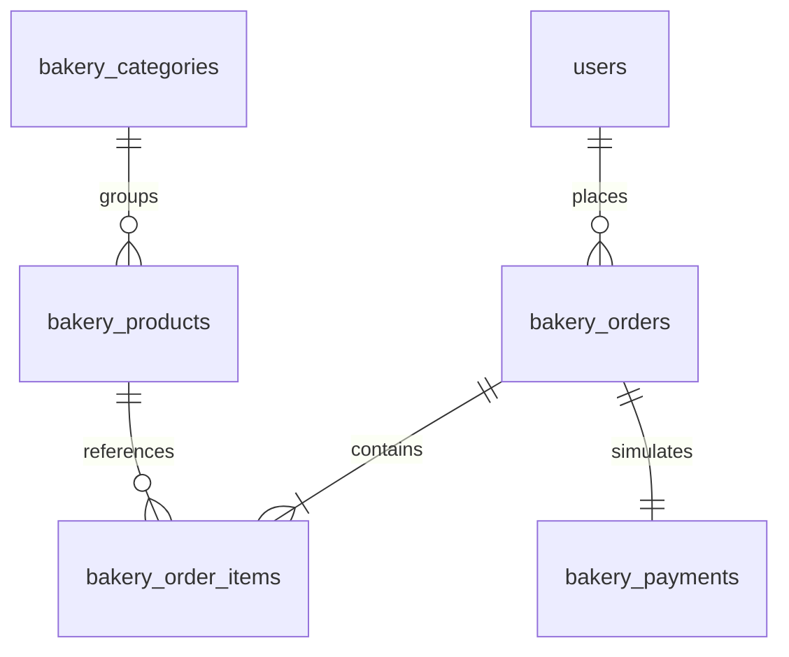

# Implementation study: Mithi Bakehouse

This is an educational reference built on the existing framework, not a production
payment integration. Read [BAKERY_PLAN.md](BAKERY_PLAN.md) for the initial assessment
and milestones, and [FEATURE_MAP.md](FEATURE_MAP.md) for a route-to-code index.

## 1. Architecture and directory structure

`backend/__init__.py:create_app` still delegates to
`backend/framework/application.py:create_application`. The factory configures
Flask, SQLAlchemy, CSRF, rate limiting, login/session validation, migration tooling,
security headers and registered modules. `backend/module_registry.py` adds one
custom `backend.modules.bakery.routes` blueprint. No framework replacement or new
runtime dependency was necessary.

| Directory/file | Responsibility |
| --- | --- |
| `backend/modules/bakery/routes.py` | HTTP adapters, owner/admin scopes, page queries, seed command |
| `backend/modules/bakery/service.py` | Cart validation, checkout, stock, order transitions, money/statistics |
| `backend/modules/bakery/seed.py` | Explicit repeatable sample catalogue |
| `database/models/bakery.py` | Relationships, Numeric money, constraints and indexes |
| `database/migrations/versions/2e96d6aea48d_add_bakery_catalogue_ordering_and_.py` | Reviewed additive schema and reverse migration |
| `frontend/templates/bakery/` | Product cards, catalogue/detail, cart, checkout, orders and administration |
| `frontend/templates/public/home.html` | Bakery landing and preserved published website pages |
| `frontend/templates/dashboard/index.html` | Customer orders plus preserved framework workspace |
| `frontend/static/css/bakery.css` | Responsive bakery theme after existing framework CSS |
| `frontend/static/js/bakery.js` | Checkout busy feedback; forms also work without JavaScript |
| `frontend/static/images/bakery/` | Original, self-contained SVG illustrations |
| `tests/test_bakery.py` | Domain/HTTP/security/concurrency/migration regression tests |

The original Notes and Pages resource engine remains usable. Custom routes were
chosen because checkout is a transaction across several tables, rather than one
record's CRUD operation. Existing contact and account modules are reused directly.

## 2. Relational model

`Category` supplies a unique name/slug. `Product` stores category, description,
allergen text, Numeric(12,2) price, available stock, active flag, illustration key
and a version. `Order` belongs to an existing User and records pickup information,
Numeric(14,2) total, order status, restoration flag, version and timestamp. Its
`(user_id, checkout_token)` uniqueness is a final database guard against replay.
`OrderItem` snapshots product name and unit price at purchase; its quantity is a
positive integer no greater than 99. One product appears at most once per order.
`Payment` is a one-to-one record with method, scenario, amount and separate status.

Foreign keys preserve historical references: products are deactivated, never deleted
through the UI. Order items/payments cascade only when their order is deleted;
there is no order-delete endpoint. Users cannot be removed through the bakery.
Database checks reject negative stock, nonpositive money and invalid statuses.
Indexes support owner history, status lists, category/active catalogue queries and
date reporting. `Order.total == sum(items)` and payment equality are service-owned
cross-table invariants, not SQL check constraints.

Migrations were generated from metadata, reviewed for foreign keys, precision,
constraints, indexes and downgrade order. `test_migration_roundtrip_and_schema_check`
uses an empty disposable database to downgrade/upgrade/check and reseed. Never
run that test's destructive downgrade on a live database. Do not use `create_all`
as a replacement for applying migrations.

## 3. Request and response lifecycle

For `POST /cart/1`, CSRF middleware checks the form, `routes.cart_change` validates
an integer quantity and reads Product stock, then writes only product IDs and
quantities to the signed session cookie. It redirects with 303 to `/cart`.
`service.cart_summary` reloads products and calculates Decimal subtotals.

For `POST /checkout`, Flask-Login requires an active authenticated session, CSRF
checks the request, the route checks the checkout token, and `service.checkout`
performs one transaction. A 303 redirect shows the persisted receipt. Validation
errors re-render checkout with a visible error and HTTP 422. Stale tokens return
409. A busy database returns a safe retry message, not internal SQL details.
GET requests never create orders or change inventory.

For `POST /admin/bakery/products/1`, a fresh administrator login is required before
`save_product` validates input, checks the product version and commits an audit
record with the change. Invalid input returns 422 with submitted values preserved.

## 4. Authentication and authorization

Reuse `backend/modules/auth/service.py` for hashed passwords, session rotation,
registration and authentication. The factory's user loader validates account
activity and `session_version`; existing password/account changes revoke prior
sessions. Public registration still creates only `member` accounts. Administrator
creation remains an owner-console action in `backend/cli.py:create_admin`.

`routes.owned_order` scopes customer receipts by both ID and `current_user.id`;
another customer's receipt returns 404. `/orders` also filters by owner. Admin
views/edits use `fresh_login_required` plus the existing
`backend/common/security.py:admin_required`. The write service rechecks the actor's
active/admin state after acquiring the transaction lock. Owner IDs always come
from the logged-in session, never from submitted hidden fields.

Tests: existing `tests/test_auth.py`, bakery
`test_order_permissions_and_administration`,
`test_registration_preserves_anonymous_basket`, and checkout price/owner tampering.
Alternatives: a second auth system would duplicate hashing/session risk; a policy
library could help larger permission matrices but is unnecessary here.

## 5. Shopping cart

Problem: allow anonymous browsing without trusting browser prices. A bounded map
of string product IDs to integer quantities is saved as `session['bakery_cart']`.
`normalize_cart` limits distinct products to 20 and quantities to 1–99. No prices,
user IDs or payment results are read from the cart. `cart_summary` calculates each
line from current database prices using Decimal. Unavailable items remain visible
so the customer can remove or reduce them. Clear-cart is a CSRF-protected POST.

`auth.service.start_session` keeps only this validated basket across login or signup
while clearing authentication state and CSRF tokens. It does not retain checkout
tokens. Logout clears the cart with the session. The cart is signed, not encrypted;
it contains no private financial data. It is browser-local, not cross-device.

Files: `routes.cart`, `cart_change`, `cart_clear`; `service.normalize_cart`,
`cart_summary`; `bakery/cart.html`. Tests cover add/update/remove, Decimal totals,
invalid quantities, stock limits, anonymous login and registration preservation.
A database cart would allow device sync and larger baskets but requires ownership,
expiry and anonymous-cart merge policies.

## 6. Checkout and idempotency

`routes.checkout` assigns a UUID checkout token on GET. Editing/clearing the basket
invalidates it. On POST, the route rejects stale/forged tokens, or retrieves an
already-created receipt by the same user/token after a lost response. The service
also looks up that token under the database write lock, preventing simultaneous
submissions from creating multiple orders.

`service.checkout` acquires the lock, revalidates the user, validates the entire cart
and pickup details, reads authoritative prices, decrements stock conditionally,
creates Order/OrderItems/Payment/AuditEvent, applies the simulated outcome and
commits once. Any exception rolls back the whole transaction. Failed payment
attempts are intentionally committed as cancelled orders, rather than erased.
The cart clears only after an order has been recorded. An empty cart is rejected.

`test_successful_checkout_server_prices_snapshots_and_replay` submits forged totals,
prices and user IDs and verifies the database determines all of them.
`test_duplicate_checkout_token_under_concurrency` verifies one order and one stock
deduction. `test_checkout_transaction_rolls_back_after_write_failure` forces a
failure after reservations to verify rollback. A production gateway would require
an intent table, durable idempotency keys, webhooks and signature verification;
none is simulated by pretending to call a real provider.

## 7. Simulated payments

`service.METHODS` and `SCENARIOS` are server-side allowlists. The checkout template
states that no money moves and asks for no financial credentials. These are explicit
test controls, not a real payment approval mechanism.

| Method/scenario | Payment status | Order status | Inventory |
| --- | --- | --- | --- |
| GCash/card success | paid | pending | reserved |
| GCash/card declined/insufficient | failed | cancelled | restored |
| GCash/card cancellation | cancelled | cancelled | restored |
| Cash, successful reservation | unpaid | pending | reserved |
| Ready cash order, admin collection | paid | ready | reserved |
| Paid order cancelled before completion | refunded | cancelled | restored |

Cash failures are rejected as invalid input rather than inventing an electronic
cash failure. Cash collection is also a simulation, guarded by an admin action and
allowed only for ready unpaid cash orders. Completion is impossible while unpaid.
Payment and order status remain separate throughout.

Files: `service.checkout`, `collect_cash`, `transition`, checkout/receipt templates.
Tests: `test_payment_scenarios`, `test_valid_transitions_cash_collection_and_financials`,
`test_stale_checkout_token_and_cash_scenario_http`. Real gateways would require a
separate integration, legal/operational work and a different security assessment.

## 8. Inventory consistency and order state machine

A cart does not reserve stock. Checkout subtracts available stock. The existing
`site_state` row is updated first: SQLite obtains a real write lock and PostgreSQL
serializes on the row. Catalogue inventory edits, checkout, order transitions and
cash collection all use this lock. After locking, ORM state is refreshed.
Each stock decrement additionally checks `active`, `stock >= quantity` and the
product version in SQL, increments the version and checks the affected-row count.
This avoids relying on an earlier browser availability check.

Allowed states: pending → preparing → ready → completed; any nonterminal state may
be cancelled by an administrator. Customers can cancel only their own pending
orders. Completed/cancelled states are terminal. Versioned forms reject stale tabs.
`restore_stock` increments each item's stock and product version once; the
`stock_restored` flag commits in the same transaction. A paid cancellation is a
simulated refund. Failed orders cannot later be revived or completed. Stock edits
set *available* quantities, excluding existing reservations. Later cancellation adds
the reservation back even if an administrator has replenished available stock.

Tests: last-item and duplicate-token concurrency tests use separate connections
and a thread barrier; cancellation, double cancellation, stale edit, invalid state,
inventory check constraint and replenishment/restoration tests cover invariants.

Tradeoff: the global row lock is deliberately easy to study and appropriate for
this small app. It serializes unrelated product writes. A high-throughput system
could use per-product locks in a stable order, a stock movement ledger and retryable
transactions. Unpaid cash reservations here do not expire automatically; admins
must cancel abandoned orders. There is no background reservation worker.

## 9. Financial calculations

`service.financial_summary` performs SQL aggregations against persisted records.
Completed paid sales require `Order.status == completed` AND `Payment.status == paid`.
Failed, cancelled and refunded payments never count. Separate cards show unpaid
cash obligations and paid orders awaiting fulfilment. Average order value divides
completed revenue by the qualifying order count, with zero-safe empty results.

Best sellers sum quantities and snapshotted line prices of qualifying orders.
Product-name snapshots keep historical labels; a renamed product can appear under
multiple historical names. Sales bars aggregate qualifying orders by creation date
(UTC), showing the latest 14 dates with sales, not a continuous calendar or completion
date report. Native HTML `meter` bars have text equivalents and no chart dependency.

Money uses Python Decimal and SQL Numeric columns, never client totals or Python
floating-point arithmetic. SQLite's Numeric affinity does not offer PostgreSQL's
exact-decimal storage guarantees; two-place inputs, bounded values and receipt
formatting fit this educational workflow. Exact integer-cent storage or PostgreSQL
Numeric would be stronger alternatives for a real financial ledger. Rounding and
currency conversion, taxes, refunds settled externally, accounting periods and
formal revenue recognition are outside this app's scope.

Tests: `test_valid_transitions_cash_collection_and_financials` creates paid,
unpaid, failed and refunded orders and verifies revenue, count, average, daily sales
and bestseller units. `bakery/admin.html` renders these results, not sample chart data.

## 10. Catalogue, design and accessibility

The landing queries active in-stock featured products; catalogue/detail queries
come from Product/Category. Filtering uses category slugs, escaped search terms,
a sort allowlist and bounded pagination. Inactive products are excluded publicly;
sold-out products remain visible with disabled purchasing. Server stock checks
still reject forged submissions. Product forms restrict images to bundled keys.

`bakery.css` uses warm paper, guava red and cocoa, serif headings, responsive grids
and a mobile sidebar inherited from the framework. Local SVG art is illustrative;
it is not represented as product photography. Inputs have visible labels, focus
outlines, stock and payment states have text, and errors use status notices.
Reduced-motion preferences are respected. Tables scroll within their containers.
Busy feedback and confirmation dialogs enhance ordinary server forms; checkout and
cart work without JavaScript. Original account/contact templates inherit the theme.

Files: `_cards.html`, `products.html`, `product.html`, home/base/sidebar templates,
`bakery.css`, `bakery.js` and original `app.js` for navigation/confirmation.
Tests: catalogue route/asset tests, stock tampering tests and Chromium viewport/
workflow checks recorded in BAKERY_VALIDATION.md. A full WCAG audit and testing
with several real assistive technologies remain future work.

## 11. Administration and preserved features

Inventory create/edit/deactivate is a fresh-admin-only workflow. The service
validates finite positive two-decimal prices, category/image allowlists, text bounds
and integer stock. Version checks prevent an old inventory tab from overwriting
stock sold since it was opened. There is no destructive product-delete UI.

Orders can be filtered by status; receipt pages expose only permitted transitions.
Cash collection is explicit, audited and separate from fulfilment. The financial
page links to customer inquiries. Existing `public.contact` and
`admin.inquiries` continue storing, validating and resolving Inquiry records.
Accounts, notes, published pages, files and activity stay available under their
original URLs. The customer dashboard adds recent orders and retains its original
workspace section. Tests include the original suite as a regression baseline.

## 12. Security and reliability

Preserved protections include password hashing, CSRF on every mutation, parameterized
ORM queries, fresh-login admin actions, revoked/inactive session checks, safe login
redirects, HTTP-only session cookies and existing CSP/security headers. Permanent sessions last eight hours from login; automatic refresh
on ordinary reads is disabled so a late static response cannot overwrite a newer
basket/checkout-token cookie. Jinja escapes
names, descriptions and pickup notes; no user HTML is marked safe. Product image
keys cannot traverse directories or point at external URLs. Pickup data is visible
only to the owner and administrators. Audit events record mutations without payment
credentials. Private .env, SQLite databases and generated runtime output stay ignored.

The basket never supplies authoritative prices. Tokens are owner-scoped and protected
by CSRF plus a unique database constraint; a token is not an alternative login.
Domain failures roll back; operational lock errors show safe retry messages. Forms
preserve errors, and the underlying application logs request IDs. No remote network
calls occur during payment simulation. Account/contact rate limits are retained.
Checkout-specific abuse limits, bot controls, data-retention jobs and operational
alerting would be sensible future additions before public deployment.

## 13. Alternatives and tradeoffs

- Server-rendered Jinja instead of a SPA: fewer dependencies, progressive enhancement,
  existing auth/CSRF reuse, easy Windows setup; full navigation reloads are accepted.
- Custom domain services instead of generated CRUD: clearer transaction boundaries
  and invariants for multi-table orders; generic notes/publishing still use resources.
- Signed session cart instead of database cart: no anonymous rows/cleanup; limited
  size and no device synchronization.
- One final simulated payment outcome instead of an asynchronous gateway: deterministic
  educational scenarios; no fraud checks, webhook lifecycle or actual refunds.
- Database lock + version checks instead of an inventory worker: simple correctness
  on SQLite; serial write throughput and no automatic reservation expiry.
- Original SVG illustrations instead of external image services: offline reliability
  and clear ownership; category art is shared across similar sample products.
- Numeric/Decimal instead of floats: ordinary currency arithmetic is readable;
  SQLite affinity remains a documented storage limitation for production accounting.

## 14. How to study, reproduce and extend

Start with `service.checkout` and follow its calls into the models and receipt template.
Run `python -m pytest tests/test_bakery.py -q` to observe the behavioural contract.
Read `tests/conftest.py` to see isolated migrations, users and temporary databases;
never point tests at a live database. Run the full suite and Ruff after changes.
Use the Windows commands and demo checklist linked from README. Both initial and
repeat setup seed safely without resetting stock or creating shared credentials.

Next useful extensions: persist carts per user; add reservation expiry with a stock
ledger; split the coarse write lock by product; add category management, image upload
moderation, pickup scheduling, integer-cent accounting and reporting ranges; add
PostgreSQL bakery integration tests; implement a real sandbox gateway with verified
webhooks only as a separate project. Migration/Windows compatibility should be
checked in CI. The existing PostgreSQL integration test verifies the generic framework,
not all bakery concurrency semantics. No production deployment is claimed.
